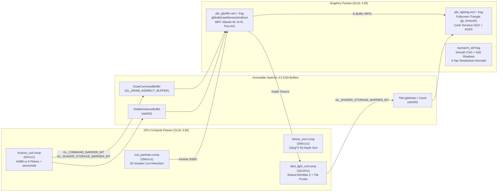

# glsl-compute-engine

A senior-level **GLSL 4.60 + Modern OpenGL 4.6 DSA + C++20** GPU compute and GPU-driven rendering architecture showcasing production shader engineering, explicit `std140`/`std430` host-device ABI parity, indirect draw compaction, tiled light culling, Cook-Torrance PBR, and real-time SDF raymarching.

## Architecture Overview



## Shader Catalog & Resource Bindings

All shaders target `#version 460 core`, use zero bare non-opaque uniforms, declare explicit `binding` and `location` qualifiers, and pass both `glslangValidator` (OpenGL GLSL) and `glslangValidator -G` (OpenGL 4.60 SPIR-V).

### Compute Shaders (`shaders/compute/`)

| Shader | Workgroup | Algorithm Highlights | UBO / SSBO / Texture Bindings |
| :--- | :--- | :--- | :--- |
| `curl_particles.comp` | `256 x 1 x 1` | 3D Ashima/Gustavson Simplex noise, 3-channel vector potential, central finite-difference divergence-free curl advection, softened point-attractor force, elastic bounding sphere, deterministic PCG respawn | UBO `0`: `CurlSimParams`<br/>SSBO `0`: `ParticleBuffer` |
| `frustum_cull.comp` | `64 x 1 x 1` | Positive-vertex (`p-vertex`) AABB vs. 6 Gribb-Hartmann frustum planes, `atomicAdd` compaction into per-draw `DrawElementsIndirectCommand` slices | UBO `0`: `CameraFrustumUBO`<br/>SSBO `0`: `ObjectBoundsBuffer` (ro)<br/>SSBO `1`: `DrawCommandBuffer`<br/>SSBO `2`: `VisibleInstanceBuffer` (wo) |
| `bitonic_sort.comp` | `256 x 1 x 1` | Disjoint-pair GPU parallel bitonic merge sort on `(float depthKey, uint payloadIndex)` with deterministic tie-breaking across `(stageK, passJ)` passes | UBO `0`: `BitonicSortParams`<br/>SSBO `0`: `SortBuffer` |
| `tiled_light_cull.comp` | `16 x 16 x 1` | Forward+ / Tiled Deferred `16x16` screen-space light culling: view-space linear depth reconstruction, `shared uint` `atomicMin`/`atomicMax` via `floatBitsToUint`, 4 inward view-space tile frustum planes, coalesced SSBO export | UBO `0`: `TileCullUBO`<br/>Sampler `0`: `uDepthTexture`<br/>SSBO `0`: `PointLightBuffer` (ro)<br/>SSBO `1`: `TileLightIndexBuffer` (wo)<br/>SSBO `2`: `TileLightCountBuffer` (wo) |

### Graphics Shaders (`shaders/graphics/`)

| Shader Pair | Key Techniques | Bindings & Explicit Locations |
| :--- | :--- | :--- |
| `pbr_gbuffer.vert`<br/>`pbr_gbuffer.frag` | GPU-driven instanced geometry pass using `gl_BaseInstance + gl_InstanceID` into compacted `visibleInstanceIds[]`, Gram-Schmidt TBN tangent-space normal mapping, bitmask-gated glTF-style PBR maps | UBO `0`: `CameraUBO`; SSBO `0`: `VisibleInstanceBuffer`; SSBO `1`: `InstanceDataBuffer`<br/>Samplers `0..3`: Albedo, Normal, MetallicRoughness, Occlusion<br/>MRT `location = 0..2`: `AlbedoMetallic`, `NormalRoughness`, `PositionAO` |
| `pbr_lighting.vert`<br/>`pbr_lighting.frag` | VBO-less fullscreen triangle (`gl_VertexID`), Cook-Torrance microfacet BRDF (GGX NDF, Smith-Schlick geometry, Fresnel-Schlick), per-tile point light accumulation with Karis smooth-windowed attenuation, Narkowicz ACES filmic tone mapping & gamma | UBO `0`: `LightingUBO`<br/>Samplers `0..2`: G-Buffer MRTs<br/>SSBO `0..2`: `PointLightBuffer`, `TileLightIndexBuffer`, `TileLightCountBuffer` |
| `raymarch_sdf.frag` | Real-time sphere tracing with adaptive hit epsilon, cubic smooth CSG union (`sminCubic`) & smooth subtraction, domain-repeated colonnade pillars, 4-tap analytic tetrahedron gradient normals, improved penumbra soft shadows, 5-tap SDF ambient occlusion, Fresnel rim lighting, ACES tone mapping | UBO `0`: `RaymarchUBO`<br/>Input `location = 0`: `vUv` (pairs with `pbr_lighting.vert`)<br/>Output `location = 0`: `oFragColor` |

## Host-Device Memory Layout (`std140` / `std430`)

Every GPU-shared C++20 struct in `include/glengine/math.hpp` is verified at compile time with `static_assert` on `sizeof`, `alignof`, and `offsetof` to guarantee exact ABI parity with GLSL 4.60:

| C++ Struct (`glengine::`) | GLSL Block / Struct | Layout | Size (Bytes) | Alignment |
| :--- | :--- | :--- | :---: | :---: |
| `GpuParticle` | `Particle` (`curl_particles.comp`) | `std430` | `32` | `16` |
| `GpuPointLight` | `PointLight` (`tiled_light_cull.comp`, `pbr_lighting.frag`) | `std430` | `32` | `16` |
| `ObjectBounds` | `ObjectBounds` (`frustum_cull.comp`) | `std430` | `48` | `16` |
| `DrawElementsIndirectCommand` | `DrawElementsIndirectCommand` (`frustum_cull.comp`) | `std430` | `20` | `4` |
| `GpuSortEntry` | `SortEntry` (`bitonic_sort.comp`) | `std430` | `8` | `4` |
| `BitonicSortParamsUbo` | `BitonicSortParams` (`bitonic_sort.comp`) | `std140` | `16` | `16` |
| `CurlSimParamsUbo` | `CurlSimParams` (`curl_particles.comp`) | `std140` | `80` | `16` |
| `CameraFrustumUbo` | `CameraFrustumUBO` (`frustum_cull.comp`) | `std140` | `112` | `16` |
| `TileCullUbo` | `TileCullUBO` (`tiled_light_cull.comp`) | `std140` | `160` | `16` |
| `InstanceDataGpu` | `InstanceData` (`pbr_gbuffer.vert`) | `std430` | `176` | `16` |

## C++20 Modules (`include/glengine/` & `src/`)

- **`math.hpp`**: Zero-dependency column-major `Mat4`, `Vec2`/`Vec3`/`Vec4`/`UVec4`, `AABB`, Gribb-Hartmann `Frustum` plane extraction, and all `std140`/`std430` GPU POD structs.
- **`shader_preprocessor.hpp/.cpp`**: Recursive `#include` resolver with cycle & max-depth protection, `#define` macro injection preserving `#version` on line 1, `#line <line> <fileId>` directive mapping, and shader stage inference.
- **`reference_algorithms.hpp/.cpp`**: Exact CPU reference implementations of AABB frustum culling + indirect draw compaction, bitonic merge sort, and Cook-Torrance GGX PBR BRDF for headless CI verification.
- **`gpu_profiler.hpp/.cpp`**: Non-stalling ring-buffered `GL_TIME_ELAPSED` query manager (`GpuTimerQueryRing`) paired with a rolling-window `TimingAccumulator` (EMA smoothing, min/max, `p50`/`p95`/`p99` percentiles).
- **`gl46_api.hpp` & `gl_compute_runtime.hpp/.cpp`**: Modular OpenGL 4.6 Direct State Access (DSA) runtime (`glCreateBuffers`, `glNamedBufferStorage`, `glDispatchCompute`, `glMemoryBarrier`, `glMultiDrawElementsIndirect`) compiled when `-DENABLE_OPENGL_RUNTIME=ON`.

## Build, Test & Shader Validation

### 1. Validate All Shaders (OpenGL GLSL + OpenGL 4.60 SPIR-V)

```bash
for s in shaders/compute/*.comp shaders/graphics/*.vert shaders/graphics/*.frag; do
  glslangValidator "$s"
  glslangValidator -G "$s" -o "/tmp/$(basename "$s").spv"
done
```

### 2. Build Headless Core Library & Run CTest Suite (CI Default)

```bash
cmake -S . -B build -DCMAKE_BUILD_TYPE=Release \
  -DENABLE_OPENGL_RUNTIME=OFF \
  -DENABLE_TESTS=ON
cmake --build build --parallel
ctest --test-dir build --output-on-failure
```

If `glslangValidator` is installed on your `PATH`, CMake also exposes the shader validation target:

```bash
cmake --build build --target validate_shaders
```

### 3. Build Desktop OpenGL 4.6 DSA Runtime & Demo

```bash
cmake -S . -B build-gl -DCMAKE_BUILD_TYPE=Release \
  -DENABLE_OPENGL_RUNTIME=ON \
  -DENABLE_TESTS=ON
cmake --build build-gl --parallel
./build-gl/glengine_demo
```

## License

MIT — see [LICENSE](LICENSE).
